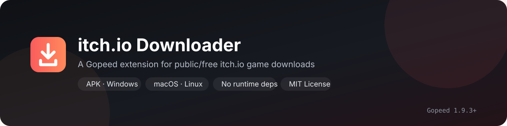
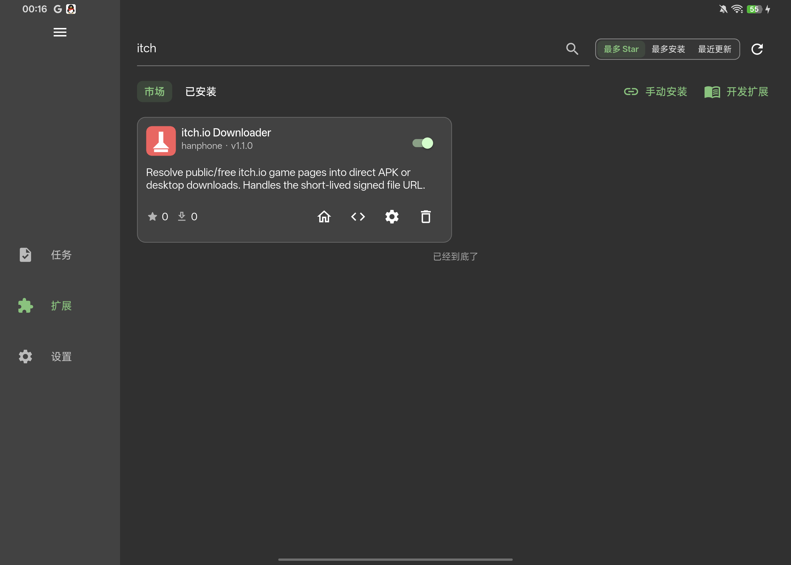

<p align="center">
  
</p>

# itch.io Downloader for Gopeed

<p align="center">
  <a href="LICENSE"></a>
  <a href="https://github.com/HanphoneJan/gopeed-extension-itch/releases"></a>
  <a href="https://github.com/HanphoneJan/gopeed-extension-itch/actions/workflows/test.yml"></a>
  
  
</p>

<p align="center">
  Resolve public/free itch.io game pages into a complete Gopeed file list: APK, Windows, macOS, Linux, and more.
</p>

<p align="center">
  <a href="README.md">中文</a> · <b>English</b>
</p>

---

> [!WARNING]
> **Gopeed 2.x: downloads resume automatically; no connection change needed.**
> **Gopeed 1.9.x: set HTTP connections to 1 before downloading large files.**
> itch.io download URLs expire in about 60 seconds. Gopeed 1.9.x has no extension streaming API, so a dropped connection can only retry an expired URL and may leave zero-filled holes; the APK then fails with "package is corrupt". On 2.x the extension serves a local resumable source and re-signs every range request, so a dropped connection continues from the last byte.

## Features

- Lists **every downloadable file** on the page, with real names, sizes, and platforms.
- Supports APK, Windows, macOS, Linux, and other files; it is not APK-only.
- External uploads (`External`, e.g. MediaFire or MEGA) appear on Gopeed 2.x as one `.txt` hint each with the link, so they no longer look missing.
- Optional platform sorting: APK, Windows, macOS, or Linux first.
- Handles itch.io's temporary download URLs and refreshes them before download.
- On Gopeed 2.x, **resumable downloads**: every Range request is re-signed, so a dropped connection continues from the last byte instead of leaving holes.
- Clear errors for login, age gates, no files, external links, and rate limits; never bypasses authentication.
- Optional Cookie; public pages usually need none.
- Pure JavaScript, zero runtime dependencies; does not log cookies, CSRF tokens, or signed URLs.

> [!IMPORTANT]
> Only **public/free** itch.io content is supported. The extension does not bypass login, purchase, or age checks. Respect itch.io's terms and the creator's license.

---

## Compatibility

- **Gopeed 1.9.3+**.
- Desktop and Android use the same extension API; Linux and Android have been tested.
- `itch.io` and `cloudflarestorage.com` must be reachable; configure a proxy in Gopeed if your network requires one.

---

## Install

### Gopeed extension market (recommended)

Open Gopeed → Extensions → Market and search for:

```text
itch
```

or:

```text
itch.io
```

Find **itch.io Downloader** and install it. The market extension ID is `hanphone@itch-io-downloader`.

<p align="center">
  
</p>

<p align="center"><sub>Search <code>itch</code> in the Gopeed extension market.</sub></p>

### Git / manual install

If the market has not updated yet, or you need a specific version, open Gopeed → Extensions → Manual install and enter:

```text
https://github.com/HanphoneJan/gopeed-extension-itch
```

No restart is needed; re-resolve the page after installation.

> Local developer setup, Android testing, and test scripts are documented in [docs/DEVELOPMENT.md](docs/DEVELOPMENT.md).

---

## Usage

Paste an itch.io game page, for example:

```text
https://mrdrnose.itch.io/votv
```

Then click resolve. Gopeed shows every downloadable file on the page:

- Android APK
- Windows/macOS/Linux archives or installers
- Other files uploaded by the author
- A `.txt` hint when the file is hosted elsewhere (open it for that file's link; see the troubleshooting table)

Select what you need, then download.

> [!NOTE]
> File types are determined by the **real filename** returned by itch.io. Platform labels on the page are only used for sorting; authors may name uploads differently.

> [!IMPORTANT]
> The example page `https://mrdrnose.itch.io/votv` is a **Name your own price** game. You must claim/purchase it on itch.io and put your Cookie in the extension settings before its download buttons appear. Without claiming it or providing a Cookie, the extension will report "no downloadable files"; that is expected, not a bug.

> [!WARNING]
> For large files, set the task's connection count to **1**, especially for files over 1 GB or on a slow network.

---

## Settings

| Name | Type | Default | Description |
| --- | --- | --- | --- |
| `platform` | string | `all` | `all`: every upload; `apk`: APK only; `desktop`: Windows/macOS/Linux files only. |
| `preferredPlatform` | string | `auto` | Sort order: `auto` (APK first, then desktop), `android`, `windows`, `macos`, `linux`, or `none` (page order). |
| `includeArm32` | boolean | `false` | Only applies to `platform=apk`. `platform=all` always lists arm32 APKs. |
| `externalHints` | boolean | `true` | External uploads (MediaFire, MEGA, ...) appear in the resolve dialog as one small `.txt` each, containing that file's link. Requires Gopeed 2.x; turn it off to list itch.io-hosted files only. |
| `cookie` | string | empty | Optional. Needed for login/age-gated pages; sent only to itch.io. |
| `fingerprint` | string | `chrome` | Browser fingerprint. `chrome` is recommended; `none` uses Gopeed's default client. |

Settings take effect on the next resolve.

### Only want one type of file?

Set `platform` to `apk` or `desktop` to keep only that type. Gopeed still preselects every listed file; uncheck the ones you do not want.

---

## Cookie (optional)

**Try without a Cookie first.** Public/free pages usually resolve directly. A Cookie is needed when:

- the page requires login to show download buttons;
- the page requires age confirmation and your browser session has already confirmed it;
- itch.io returns 403 for anonymous requests.

How to get it (never post it in chat, issues, or the repository):

1. Log in to itch.io and complete any required age confirmation.
2. Open developer tools → Network.
3. Refresh the game page and click the first request to `*.itch.io`.
4. Copy the **`Cookie` value** from the request headers.
5. Paste it into the extension's `cookie` setting.

> [!CAUTION]
> A Cookie is a login credential. Only include itch.io cookies; never commit it to GitHub, paste it in an issue, or write it to logs. Gopeed stores extension settings in its own configuration/storage.

---

## Signed URL lifetime

itch.io's download URL is valid for about **60 seconds**. The extension refreshes it before starting the download and tries to refresh again when a task fails with 401/403.

### Gopeed 2.x: automatic resume

2.x exposes `gopeed.runtime.blob`. The extension no longer hands the signed URL to the downloader; it registers a local resumable source:

```text
Gopeed → local blob source → every Range request → fresh itch.io signature → R2
```

What that gives you:

- Every range uses its own fresh signature, so a connection opened after 60 seconds cannot hit 403.
- A connection that ends early resumes from the last received byte, up to 40 attempts, and a partial file is never reported as complete.
- One connection or many, the file stays complete.
- If the app restarts and the task fails, `onError` rebuilds the source and continues from what is already on disk.

Verified on Gopeed 2.0.0-beta.4 (Android): after the proxy reset the connection mid-download, the task resumed from the last byte, `unzip -t` reported no errors, and the APK installed successfully.

### Gopeed 1.9.x: set connections to 1

1.9.x has no streaming API, so the extension can only return the signed URL. **Set connections to 1** and keep the network stable; a drop can still leave holes, so verify:

```bash
unzip -t filename.apk
```

`No errors detected` means the archive is complete.

Do not judge a download by its byte count of zeros: an APK can legitimately contain large zero-filled regions, so that number says nothing about integrity. Trust `unzip -t` or a successful install.

---

## Troubleshooting

| Symptom / error | Fix |
| --- | --- |
| Extension not found in the market | Search `itch` or `itch.io`; the market index may lag. You can also install via the Git URL above. |
| `Not an itch.io game page URL` | Paste `https://author.itch.io/game`, not a list page or devlog page. |
| `Missing CSRF token` | The page may need login/age confirmation; add a Cookie and retry. |
| `This page requires login` | Add a Cookie in settings. The extension does not bypass login. If the page downloads fine in a browser without logging in, update the extension: 1.2.3 fixed devlog text such as "login required" being read as a login gate. |
| `This page requires age confirmation` | Confirm age in a browser, then use that session's Cookie. |
| `No downloadable files` | The game may be unpublished, delisted, paid/claimed, or the uploads were removed. The VOTV example requires claiming the game and a Cookie first. |
| An installer from the page shows up as a `.txt` | Those uploads are marked `External` on itch.io: the files live on MediaFire, MEGA, and similar hosts, and itch.io only links to a landing page. The extension lists one small `.txt` per external upload; open it to get that file's link and download the installer in your browser. Gopeed 1.9.x has no blob API, so no hint files are generated there. |
| `Failed to get signed URL (HTTP 403)` | Cookie expired/missing, or itch.io rejected the request; refresh the Cookie or retry later. |
| `Failed to get signed URL (HTTP 429)` | itch.io rate limit; wait a few minutes. |
| Installer says "package is corrupt" | Make sure you are not reinstalling an old file: resolve again and delete the old one. On 2.x the extension resumes automatically; on 1.9.x set connections to **1** and retry. |
| Download 403/incomplete | Signed URL expired. On 2.x, reinstall the extension and check it is version 1.2.0 or newer; on 1.9.x set connections to 1 and retry. |

Logs: Gopeed's `logs/extension.log`. The extension logs only public filenames and states; URLs, cookies, CSRF values, and signed parameters are redacted.

---

## Limitations

- No paid games or pages that require purchase.
- No bypassing login or age confirmation; the user must provide a Cookie.
- No downloading of uploads that point to external sites (marked `External`, e.g. MediaFire or MEGA): itch.io only returns a landing page. The extension does not download them; on Gopeed 2.x it lists a small `.txt` per external upload with the link (setting `externalHints`, on by default), and skips them entirely when that is off. A page with only external uploads returns just those hint files on 2.x, and an explanatory error on 1.9.x.
- Only `author.itch.io` game pages.
- Page structure changes may require a parser update.
- Resumable downloads require Gopeed 2.x; 1.9.x is still bound by the 60-second signature.
- Gopeed preselects all files in the resolve dialog; the extension cannot preselect only one. Use `platform` to filter or uncheck manually.
- Host OS detection is not available; `preferredPlatform=auto` is a fixed "APK first" order, not OS detection.

---

## Security and privacy

- Cookies are sent only to `*.itch.io` and are never logged.
- CSRF tokens are used in memory and are not written to labels, storage, or logs.
- Signed URLs only exist in the Gopeed download request and Gopeed's own task data; the extension does not log them.
- A `.txt` hint for an external upload contains only that file's public landing link, no credentials.
- No cookies, tokens, signed URLs, or downloaded game files are stored in this repository.
- For security reports, read [SECURITY.md](SECURITY.md) and do not post credentials in public issues.

---

## Development and contributing

See:

- [docs/DEVELOPMENT.md](docs/DEVELOPMENT.md)
- [CONTRIBUTING.md](CONTRIBUTING.md)

---

## License

MIT © 2026 HanphoneJan. See [LICENSE](LICENSE).

## Acknowledgements

- [Gopeed](https://github.com/GopeedLab/gopeed) for the downloader and extension API.
- [itch.io](https://itch.io) for the platform.
- The open-source community for testing and documentation patterns.

> This project is not affiliated with itch.io or Gopeed. Download only content you are allowed to download.
