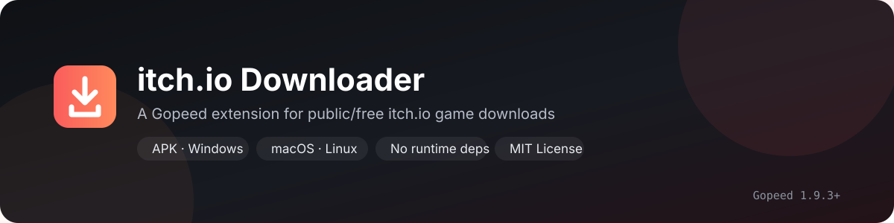
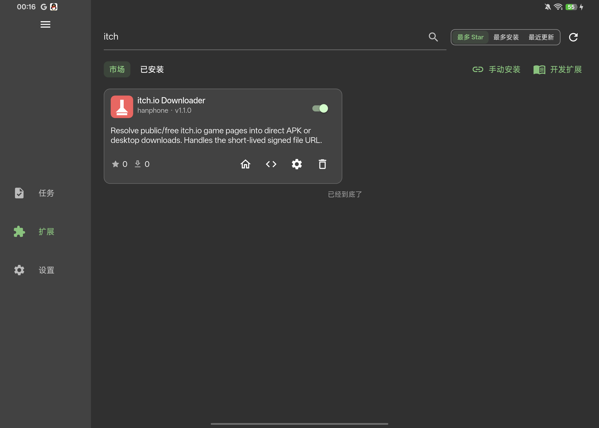

<p align="center">
  
</p>

# itch.io Downloader for Gopeed

<p align="center">
  <a href="LICENSE"></a>
  <a href="https://github.com/HanphoneJan/gopeed-extension-itch/releases"></a>
  <a href="https://github.com/HanphoneJan/gopeed-extension-itch/actions/workflows/test.yml"></a>
  
  
</p>

<p align="center">
  把公开/免费的 itch.io 游戏页面解析成 Gopeed 可直接下载的完整文件列表：APK、Windows、macOS、Linux 等。
</p>

<p align="center">
  <b>中文</b> · <a href="README.en.md">English</a>
</p>

---

> [!WARNING]
> **Gopeed 2.x：扩展会让下载自动续传，不必改连接数。**
> **Gopeed 1.9.x：下载大文件前，请把「连接数」设为 1。**
> itch.io 的下载地址只有约 60 秒有效期。Gopeed 1.9.x 没有扩展流式接口，断线后只能重试已过期的地址，文件可能出现空洞，表现为 APK 安装时提示“安装包损坏”。2.x 上扩展会用本地可续传数据源接管下载，每个分段都重新签名，断线后从最后一个字节继续。

## 功能

- 列出页面上的**全部可下载文件**，保留真实文件名、大小和平台。
- 支持 APK、Windows、macOS、Linux 等文件；不会只返回 APK。
- 页面上的外部上传（`External`，如 MediaFire、MEGA）在 Gopeed 2.x 上各显示为一个含链接的 `.txt` 提示项，不会被误当成缺失。
- 可按平台排序：APK、Windows、macOS、Linux 优先项可选。
- 自动处理 itch.io 的临时下载地址，并在开始下载前刷新。
- Gopeed 2.x 上支持**断线续传**：每个 Range 请求重新签名，网络中断后从断点继续，不会留下空洞。
- 登录/年龄门/无文件/外部链接/限流都有明确提示，不绕过认证。
- 可选 Cookie；公开页面通常不需要。
- 纯 JavaScript，无运行时依赖；不记录 Cookie、CSRF 或签名 URL。

> [!IMPORTANT]
> 仅支持**公开/免费**的 itch.io 内容。不绕过登录、购买或年龄确认。请遵守 itch.io 的服务条款和作者的授权。

---

## 兼容性

- **Gopeed 1.9.3 及以上**。
- 桌面版和 Android 版使用同一套扩展 API；Linux 和 Android 已实际验证。
- 需要能访问 `itch.io` 和 `cloudflarestorage.com`；如果网络受限，请配置 Gopeed 的代理。

---

## 安装

### 扩展市场（推荐）

打开 Gopeed → 扩展 → 市场，搜索：

```text
itch
```

或：

```text
itch.io
```

找到 **itch.io Downloader** 后点击安装。市场中的扩展 ID 是 `hanphone@itch-io-downloader`。

<p align="center">
  
</p>

<p align="center"><sub>在 Gopeed 扩展市场搜索 <code>itch</code> 即可找到。</sub></p>

### Git / 手动安装

如果市场暂时没有刷新，或需要指定版本，在 Gopeed → 扩展 → 手动安装中填入：

```text
https://github.com/HanphoneJan/gopeed-extension-itch
```

安装后无需重启 Gopeed，重新解析页面即可。

> 开发者本地调试、Android 手动测试和测试脚本说明见 [docs/DEVELOPMENT.md](docs/DEVELOPMENT.md)。

---

## 使用

粘贴 itch.io 游戏主页，例如：

```text
https://mrdrnose.itch.io/votv
```

然后点击解析。Gopeed 会显示页面上的所有可下载项：

- Android APK
- Windows/macOS/Linux 压缩包或安装包
- 作者上传的其他文件
- 托管在外部站点时的 `.txt` 提示项（打开即得该文件的下载链接，见下方排错表）

按需要勾选文件 → 下载。

> [!NOTE]
> 文件类型以 itch.io 返回的**真实文件名**为准，页面上的平台标签只用于排序。不同作者的上传命名可能不一样，请以实际文件名为准。

> [!IMPORTANT]
> 示例页面 `https://mrdrnose.itch.io/votv` 是 **Name your own price** 游戏：需要先在 itch.io 领取/购买，并在扩展设置中填写 Cookie，页面才会出现下载按钮。未领取或未提供 Cookie 时，扩展会提示“页面没有可下载文件”，这是正常现象，不是扩展故障。

> [!WARNING]
> 大文件请先把下载连接数设为 **1**，尤其是 1 GB 以上的文件或慢速网络。

---

## 设置

| 名称 | 类型 | 默认 | 说明 |
| --- | --- | --- | --- |
| `platform` | string | `all` | `all`：列出全部上传；`apk`：只返回 APK；`desktop`：只返回 Windows/macOS/Linux 文件。 |
| `preferredPlatform` | string | `auto` | 文件排序：`auto`（APK 优先，然后桌面）、`android`、`windows`、`macos`、`linux`、`none`（页面顺序）。 |
| `includeArm32` | boolean | `false` | 仅对 `platform=apk` 生效。`platform=all` 始终列出 arm32 APK。 |
| `externalHints` | boolean | `true` | 页面上的外部上传（MediaFire、MEGA 等）在解析窗口里各显示为一个 `.txt`，内容是该文件的链接。需要 Gopeed 2.x；关掉后只列 itch.io 托管的文件。 |
| `cookie` | string | 空 | 可选。登录/年龄门页面需要时填写；只发送给 itch.io。 |
| `fingerprint` | string | `chrome` | 浏览器指纹。`chrome` 最稳；`none` 使用 Gopeed 默认客户端。 |

设置修改后重新解析页面即可生效。

### 只想看某一类文件？

把 `platform` 设为 `apk` 或 `desktop`，列表就只保留对应类型。Gopeed 仍会默认勾选列出的全部文件，请按需取消。

---

## Cookie（可选）

**先不填 Cookie 试一次。** 公开免费页面通常可以直接解析；以下情况才需要：

- 页面要求登录才能看到下载按钮；
- 页面要求年龄确认，而你的浏览器会话已经确认过；
- itch.io 对匿名请求返回 403。

获取方式（不要把 Cookie 发到聊天、issue 或仓库）：

1. 登录 itch.io，并完成需要的年龄确认。
2. 打开开发者工具 → Network。
3. 刷新目标游戏页面，点第一个发往 `*.itch.io` 的请求。
4. 复制请求头里的 **`Cookie` 值**。
5. 粘贴到扩展设置的 `cookie` 字段。

> [!CAUTION]
> Cookie 等同于登录凭据。只应包含 itch.io 域名的 cookie；不要提交到 GitHub、issue 或日志。Gopeed 会把扩展设置保存在自己的配置/存储中。

---

## 下载地址有效期

itch.io 返回的下载地址约 **60 秒**有效。扩展会在开始下载前刷新一次；任务因 401/403 失败时也会尝试刷新并继续。

### Gopeed 2.x：自动续传

2.x 提供了 `gopeed.runtime.blob`。扩展不再把签名地址直接交给下载器，而是注册一个本地可续传数据源：

```text
Gopeed → 本地 blob 源 → 每个 Range 请求 → 重新向 itch.io 要一个新签名地址 → R2
```

由此带来的行为：

- 每个分段都用自己的新签名，不会出现“连接晚于 60 秒建立 → 403”。
- 连接中途断开时，扩展从最后收到的字节继续，最多重试 40 次，不会把半截文件标记为完成。
- 多连接、单连接都可以用；连接数不再影响完整性。
- 应用重启后任务失败时，`onError` 会重建数据源并从已下载的部分继续。

已在 Gopeed 2.0.0-beta.4（Android）上实测：代理在下载中途重置连接后，任务自动从断点续传完成，`unzip -t` 无错误，APK 安装成功。

### Gopeed 1.9.x：把连接数设为 1

1.9.x 没有流式接口，扩展只能返回签名地址本身。**把连接数设为 1**，并保持网络稳定；断线后仍可能留下空洞，下载完请校验：

```bash
unzip -t 文件名.apk
```

看到 `No errors detected` 才算完整。

不要用“文件里有多少个零字节”判断是否损坏：APK 内部本来就可能包含大段零数据，这个数字不能说明完整性。以 `unzip -t` 的结果或能否安装为准。

---

## 排错

| 现象/错误 | 处理 |
| --- | --- |
| 扩展在市场里搜不到 | 搜索 `itch` 或 `itch.io`；市场索引可能延迟，也可用 README 里的 Git 地址手动安装。 |
| `这不是 itch.io 游戏主页 URL` | 粘贴 `https://mrdrnose.itch.io/votv`，不要粘贴列表页或 devlog 页面。 |
| `页面缺少 CSRF token` | 可能需要登录/年龄确认；填写 Cookie 后重试。 |
| `该页面需要登录才能查看下载` | 在设置里填 Cookie。扩展不会绕过登录。如果浏览器里不登录也能直接下载，请先升级扩展（1.2.3 修复了把开发日志里的 "login required" 误判为登录门的问题）。 |
| `该页面需要年龄确认` | 先在浏览器完成年龄确认，再用同一会话的 Cookie。 |
| `页面没有可下载文件` | 可能尚未发布、已下架、需要购买/领取，或上传已移除。VOTV 示例页面需要先领取并填写 Cookie；未领取时出现此提示是正常的。 |
| 页面上的安装包在列表里是 `.txt` | 那些上传在 itch.io 上标着 `External`：文件托管在 MediaFire、MEGA 等站点，itch.io 只提供跳转页。扩展为每个外部上传列出一个小 `.txt`，打开就是该文件的下载链接，安装包本体请自己在浏览器里下载。Gopeed 1.9.x 没有 blob 接口，不会生成这些提示文件。 |
| `签名链接获取失败（HTTP 403）` | Cookie 失效/缺失，或请求被 itch.io 拒绝；重新获取 Cookie 或稍后重试。 |
| `签名链接获取失败（HTTP 429）` | itch.io 限流；等几分钟再试。 |
| 安装时提示“安装包损坏” | 先确认是否旧的损坏文件：重新解析并删除旧文件。2.x 上扩展会自动续传；1.9.x 上把连接数设为 **1** 后重试。 |
| 下载 403/文件不完整 | 临时地址过期。2.x 请重装扩展并确认版本 ≥ 1.2.0；1.9.x 把连接数设为 1 后重试。 |

日志位置：Gopeed 的 `logs/extension.log`。扩展日志只包含公开的文件名和状态；URL、Cookie、CSRF、签名参数会被脱敏。

---

## 限制

- 不支持付费游戏、需要购买的页面。
- 不支持绕过登录或年龄确认；需要用户自己提供 Cookie。
- 不支持下载指向外部站点的上传（页面标记 `External`，如 MediaFire、MEGA）：itch.io 只返回跳转页。扩展不会下载它们，而是在 Gopeed 2.x 上为每个外部上传生成一个含链接的 `.txt`（设置 `externalHints`，默认开启）；关掉后这些上传完全跳过。整页都是外部上传时，2.x 只返回这些提示文件，1.9.x 会给出说明性错误。
- 只支持 `author.itch.io` 子域名下的游戏主页。
- 页面结构变化后可能需要更新解析逻辑。
- 断线续传需要 Gopeed 2.x；1.9.x 仍受 60 秒签名限制。
- Gopeed 解析对话框会默认勾选全部文件，扩展无法只勾选一个；可用 `platform` 过滤或手动取消。
- 无法自动检测宿主系统；`preferredPlatform=auto` 是“APK 优先”的固定排序，不是系统探测。

---

## 安全与隐私

- Cookie 只在请求 `*.itch.io` 时发送；不写日志。
- CSRF token 只在内存中用于请求；不写入标签、storage 或日志。
- 签名 URL 只存在于返回给 Gopeed 的下载请求和 Gopeed 自己的任务数据中；扩展日志不输出。
- 外部上传的 `.txt` 提示项里只有该文件的公开跳转链接，不包含任何凭据。
- 不在仓库中保存 Cookie、token、签名 URL 或下载的文件。
- 安全问题请阅读 [SECURITY.md](SECURITY.md)，不要在公开 issue 中贴凭据。

---

## 开发与贡献

开发环境、Gopeed API 兼容性、单元测试、真实 Gopeed 冒烟测试和发布流程见：

- [docs/DEVELOPMENT.md](docs/DEVELOPMENT.md)
- [CONTRIBUTING.md](CONTRIBUTING.md)

---

## License

MIT © 2026 HanphoneJan. See [LICENSE](LICENSE).

## Acknowledgements

- [Gopeed](https://github.com/GopeedLab/gopeed) for the downloader and extension API.
- [itch.io](https://itch.io) for the platform.
- The open-source community for testing and documentation patterns.

> This project is not affiliated with itch.io or Gopeed. Download only content you are allowed to download.
